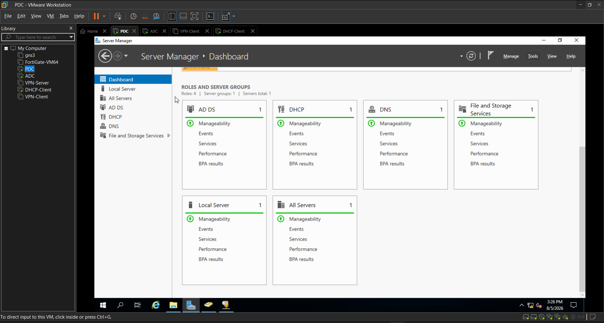
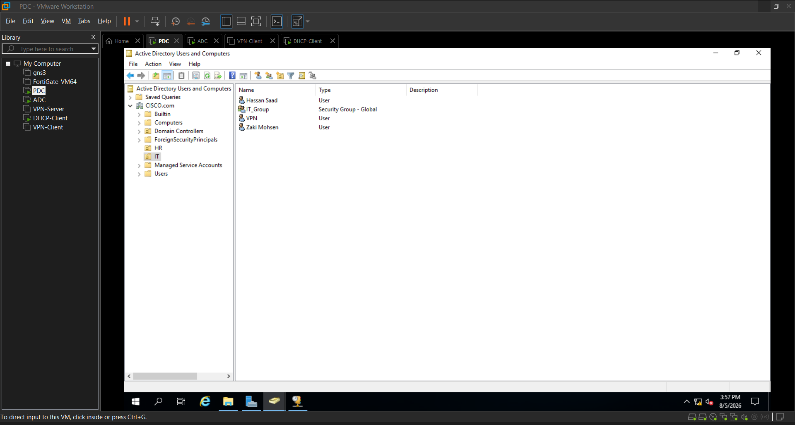
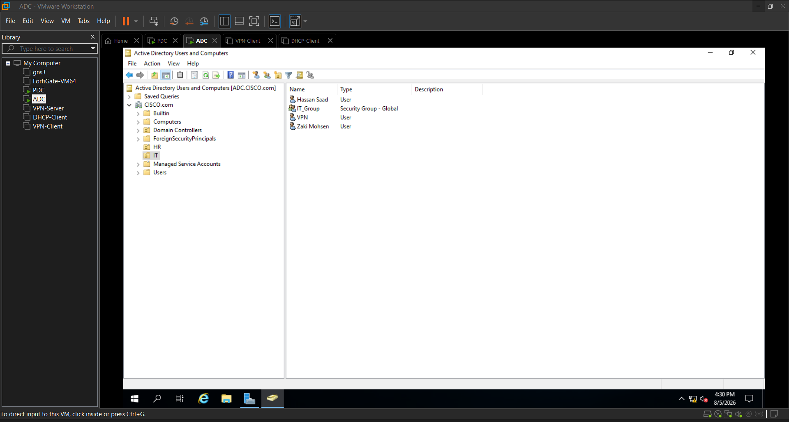

[← Back to Main README](../README.md)

# Active Directory Domain Services (AD DS)

Active Directory Domain Services (AD DS) forms the core identity and directory layer across the lab, deployed with redundancy across **two Domain Controllers** (Primary Domain Controller and Additional Domain Controller).

## Implementation Highlights

- Deployed AD DS on the Primary Domain Controller alongside DNS, DHCP, and File & Storage Services.
- Promoted an Additional Domain Controller to provide directory redundancy and AD replication across both servers.
- Structured hierarchical Organizational Units (OUs), user accounts, and security groups to support Group Policy targeting and clean administration.
- Verified synchronized directory objects across both Domain Controllers.

## Verification Screenshots

**Primary Domain Controller — Server Manager Roles**

**Active Directory OUs and Users Management**

**Additional Domain Controller — Synchronized Users & Directory View**

