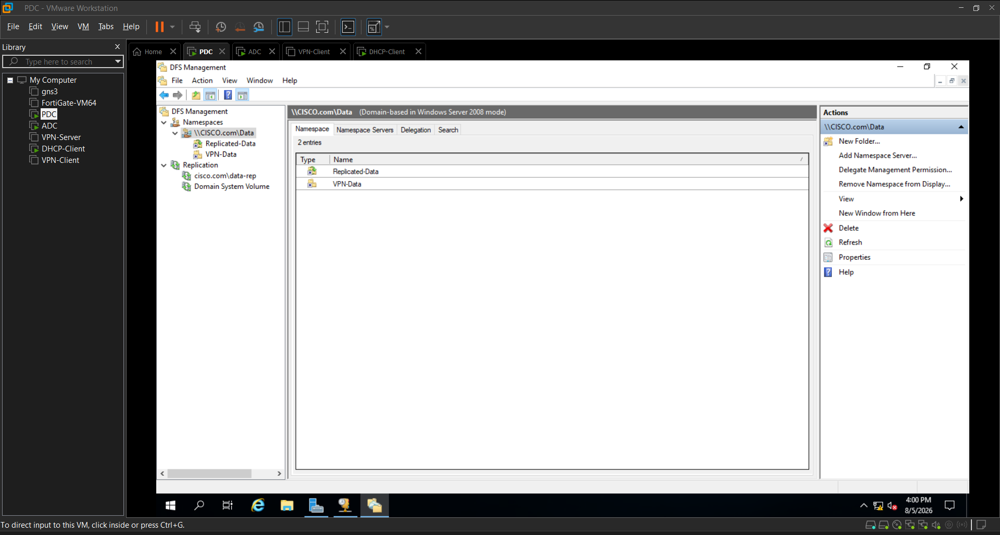
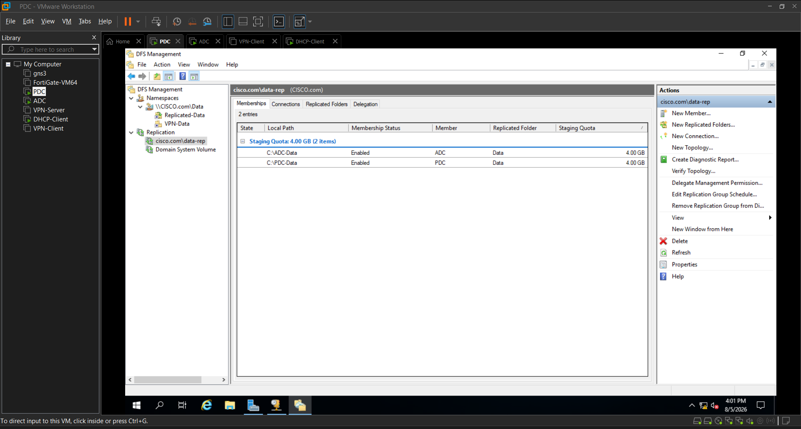
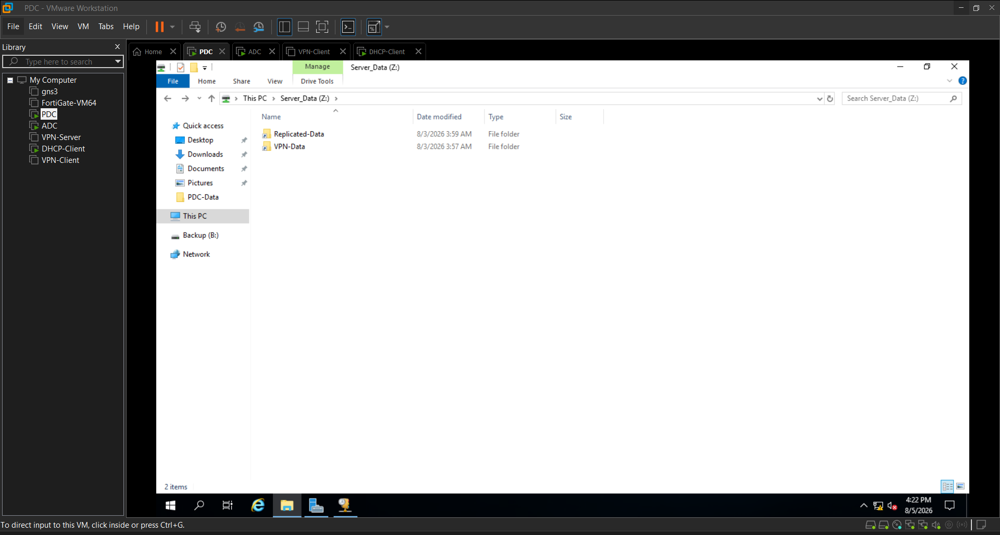
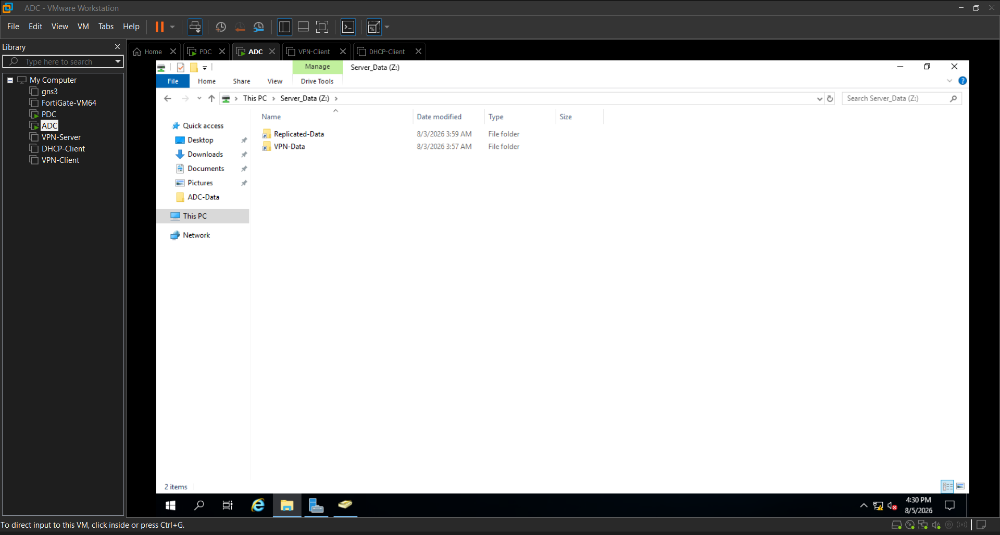

[← Back to Main README](../README.md)

# Distributed File System (DFS) & Replication

Distributed File System (DFS) provides a unified namespace for shared enterprise folders and keeps data synchronized across both servers using **DFS Replication (DFSR)**.

## Implementation Highlights

- Configured a centralized **DFS Namespace** so clients access shared folders through a consistent logical path independent of the underlying server.
- Enabled **DFS Replication (DFSR)** between the two Windows Server instances for automatic folder synchronization and storage redundancy.
- Verified synchronized shared data folders on both server contexts.

## Verification Screenshots

**DFS Namespace**

**DFS Replication**

**Primary Server Shared Data Folders**

**Additional Server Synchronized Data**

