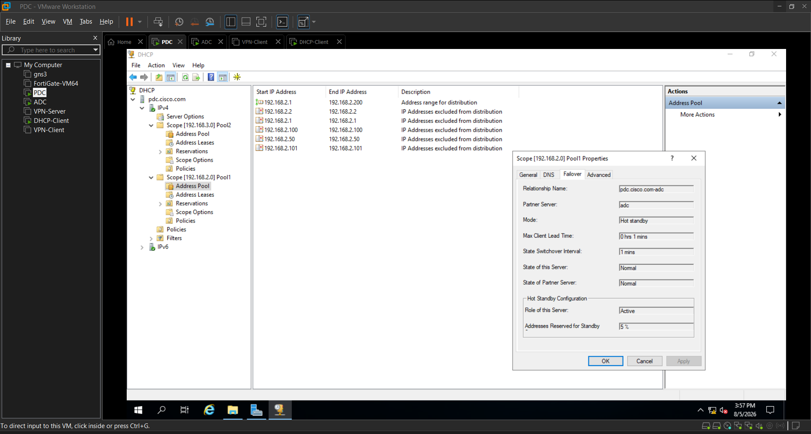
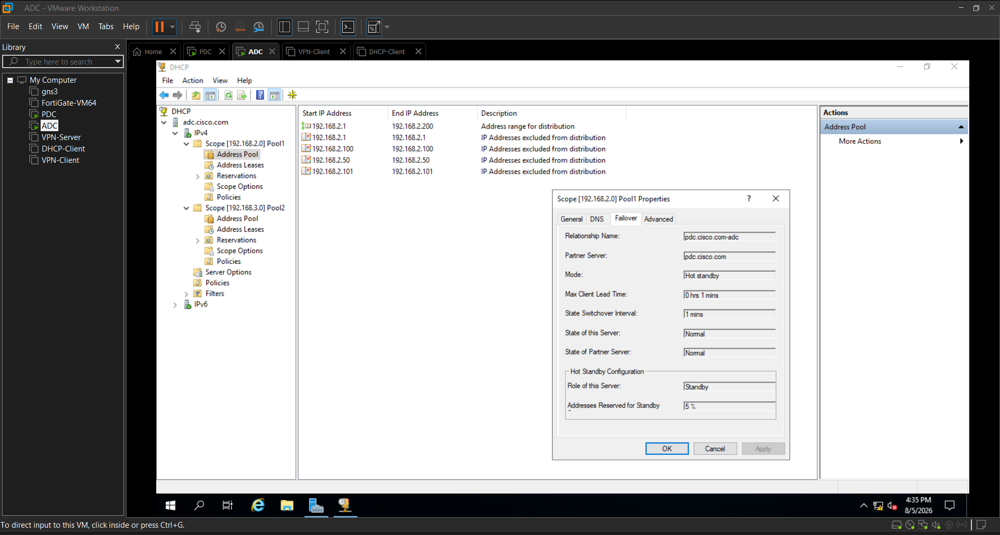

[← Back to Main README](../README.md)

# DHCP Failover

High-Availability DHCP Failover is configured between the two Windows Server 2019 servers (**Hot Standby mode**) so client IP addressing remains uninterrupted if the primary DHCP server goes offline.

## Implementation Highlights

- Configured DHCP Failover partnership between the primary and standby servers.
- Validated synchronized scope leases and active failover status across both DHCP consoles.
- Tested client lease continuity under the redundant DHCP architecture.

## Verification Screenshots

**Primary DHCP Failover Configuration**

**Secondary / Partner Failover Status**

