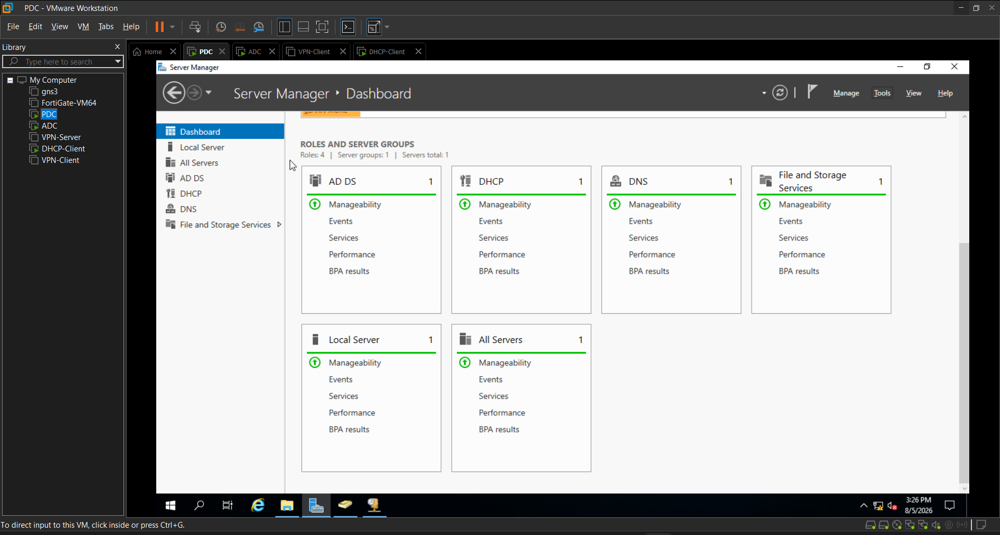
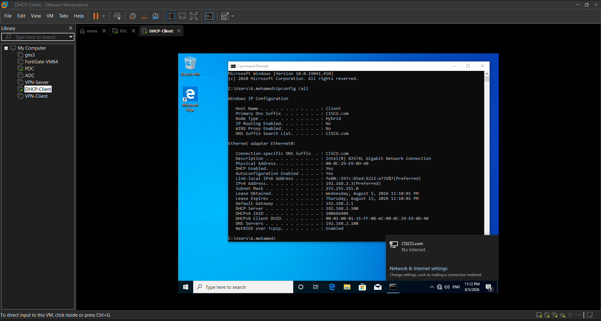
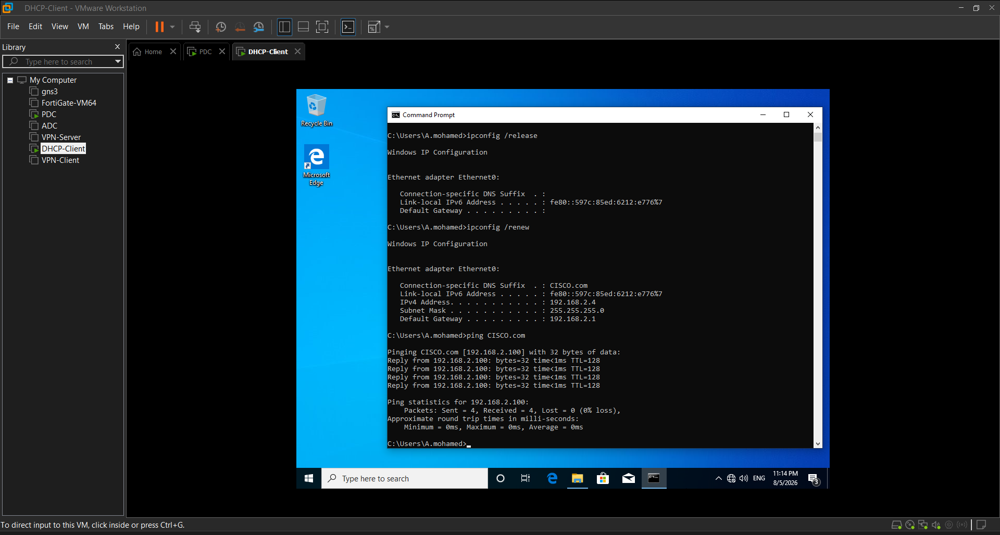
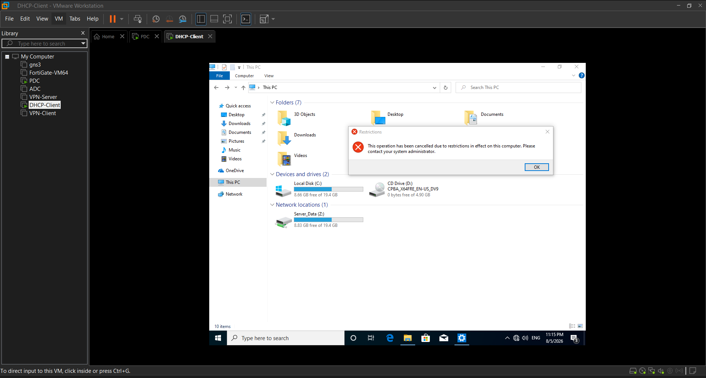
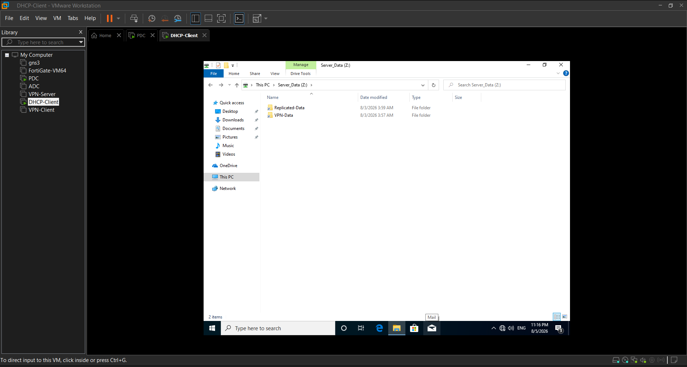

[← Back to Main README](../README.md)

# Dynamic Host Configuration Protocol (DHCP)

The DHCP Server role manages dynamic IPv4 address allocation, scope options (default gateway and DNS servers), lease renewals, and client access policies across the lab network.

## Implementation Highlights

- Configured centralized DHCP scopes to automatically assign IP configurations to domain Windows clients.
- Tested and verified dynamic lease allocation and client-side `ipconfig /release` and `ipconfig /renew` workflows.
- Configured DHCP client restrictions/filters to control lease assignment behavior.
- Integrated DHCP with high-availability failover (see [DHCP Failover](dhcp-failover.md)).

## Verification Screenshots

- **Server Role Configuration:** 
- **Client IP Allocation:** 
- **Release & Renew Test:** 
- **Client Restrictions:** 
- **Client & Server Verification:** 
