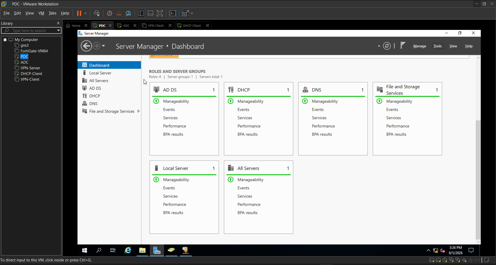

[← Back to Main README](../README.md)

# Domain Name System (DNS)

Internal DNS is deployed on the Windows Server 2019 Domain Controller and integrated directly with Active Directory Domain Services (AD DS) to support domain resolution, SRV records for domain join/authentication, and internal client name resolution across the lab.

## Implementation Highlights

- Installed and configured the DNS Server role alongside AD DS on the Primary Domain Controller.
- Provided internal name resolution for domain-joined servers, client workstations, and VPN clients.
- Used DNS alongside DHCP scope options to ensure seamless domain discovery and client connectivity.

## Verification Screenshot

