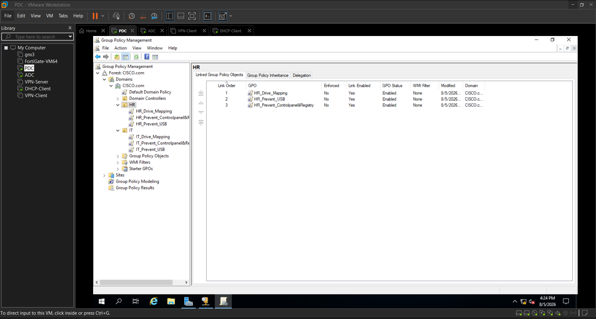
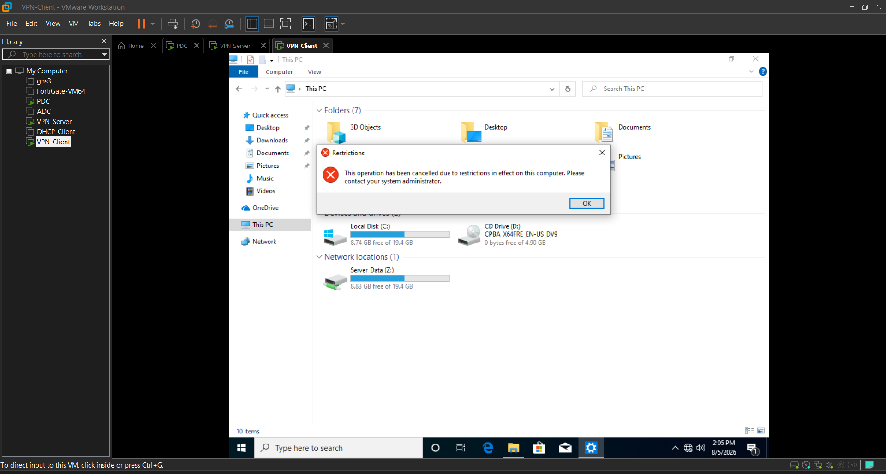

[← Back to Main README](../README.md)

# Group Policy Management (GPO)

Group Policy Objects (GPOs) enforce centralized security baselines, administrative restrictions, and consistent configuration policies across domain-joined workstations and user OUs.

## Implementation Highlights

- Created and linked custom GPOs to domain Organizational Units using Group Policy Management Console (GPMC).
- Configured endpoint security and administrative lockdown rules for domain users/workstations.
- Validated policy enforcement directly on Windows client sessions.

## Verification Screenshots

**Group Policy Management**

**GPO Security Validation**

