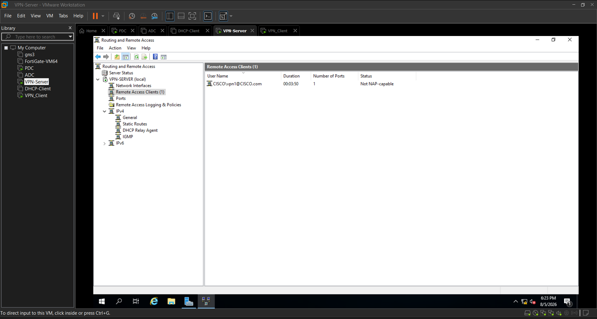
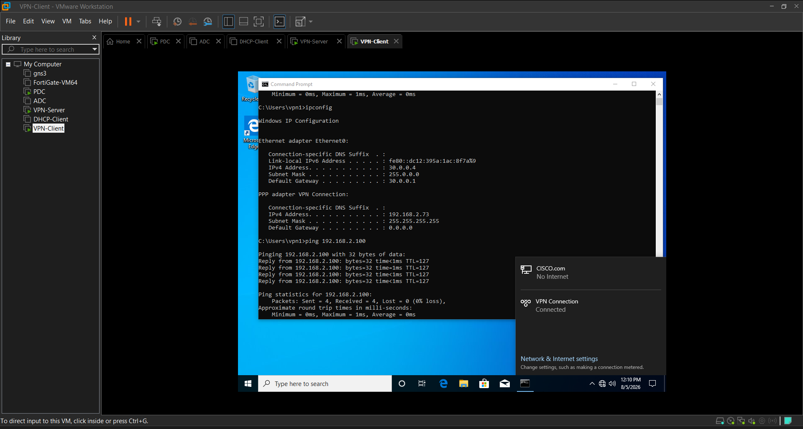
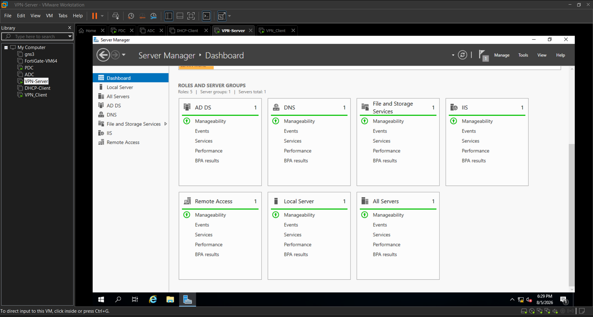
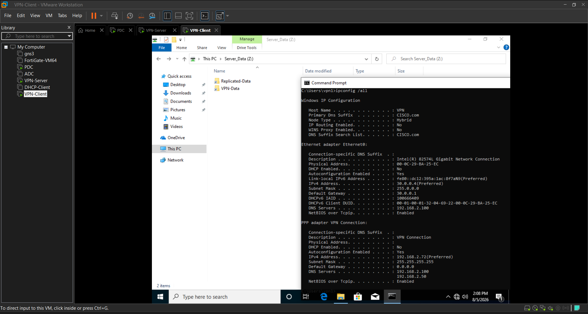

[← Back to Main README](../README.md)

# Routing and Remote Access Service (RRAS / VPN)

Windows Server **Routing and Remote Access Service (RRAS)** is configured as a secure VPN gateway to enable remote client connectivity, virtual IP assignment, and cross-subnet routing into the enterprise lab network.

## Implementation Highlights

- Configured RRAS VPN server roles and verified active remote client sessions.
- Validated VPN client IP addressing (`ipconfig`) and active gateway connection status.
- Tested end-to-end cross-subnet routing and connectivity from the connected VPN client to internal lab resources.

## Verification Screenshots

- **VPN Server & Active Client Session:** 
- **VPN Client Routing Verification:** 
- **RRAS / VPN Server Manager:** 
- **VPN Client IP Configuration:** 
